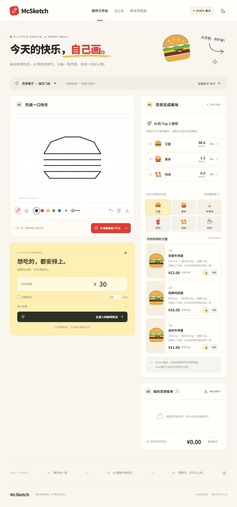
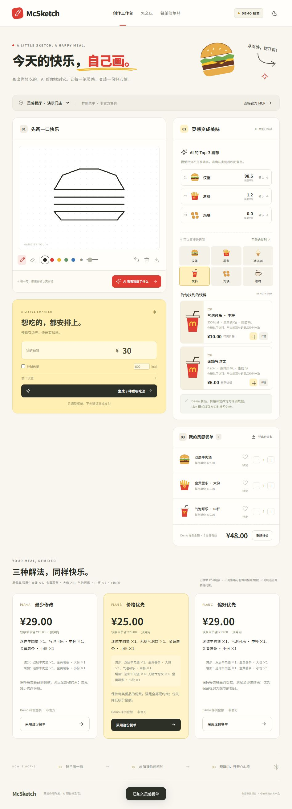
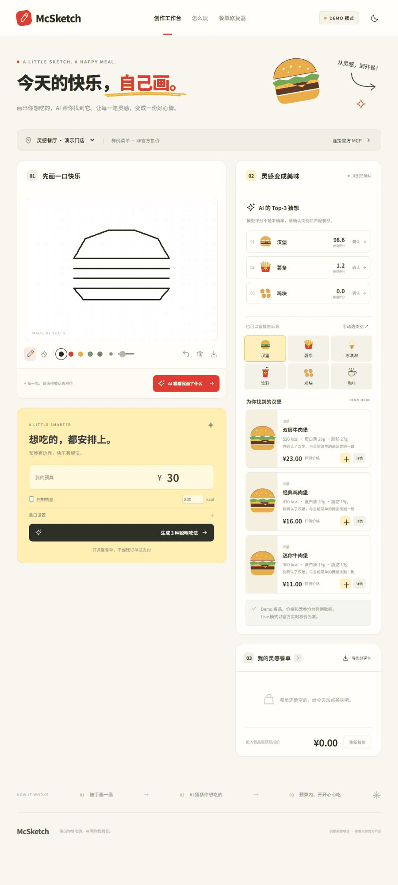
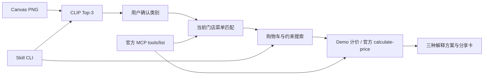

# McSketch · 麦麦画餐师

**画出你想吃的，AI 帮你找到它。**

一款把手绘、真实视觉模型、菜单匹配和预算约束搜索连接起来的创意餐单助手。面向想轻松表达“今天想吃什么”的用户，也面向希望复用该工作流的智能体。

> 独立创意参赛项目，非麦当劳官方产品。Demo 菜单名称、价格、营养和门店均为合成演示数据，不代表官方在售商品。首版只查询、推荐和核价，不创建订单或支付。



## 当前交付状态

- 可本地运行：鼠标/Pointer Events 画板、画笔粗细/颜色、橡皮擦、撤销、清空、PNG 预览与导出；移动响应式布局、深色模式。
- 真正的 CLIP 推理，Top-3、模型评分、不确定提示和人工纠正；模型无法加载时明确显示手动选择。
- 完整 Demo：门店、菜单匹配、购物车、核价、硬锁定/软偏好/忌口/热量、三种修复方案和餐单分享卡。
- Live：官方 Streamable HTTP SDK、真实 tools/list schema 校验、五个只读工具；真实门店菜单、详情和营养、默认规格报价及修复再次核价已通过。
- 当前 Live 支持到店取餐和官方默认规格；配送、预约、自定义加价规格尚未实测。营养缺失保持未知，未提供可核实的过敏原信息时不能证明忌口安全。详见 [真实联调报告](docs/LIVE_INTEGRATION_REPORT.md)。
- 已准备官方原版参赛声明、MCP 说明、配置示例、Skill、样本、截图、测试记录。没有发布 GitHub 仓库、报名或使用 WorkBuddy。

## 运行

需要 Python **3.11+**、Node.js **22.12+**、pnpm（或 npm）。本次实测 Windows + Python 3.13。

```powershell
# 在本项目根目录
python -m venv .venv
.\.venv\Scripts\python.exe -m pip install -r requirements-dev.txt

# 安装真正的视觉推理依赖（CPU；也可按 PyTorch 官方方法配置 GPU）
.\.venv\Scripts\python.exe -m pip install torch --index-url https://download.pytorch.org/whl/cpu
.\.venv\Scripts\python.exe -m pip install "transformers>=4.48,<5"

cd frontend
pnpm install
pnpm build
cd ..
.\.venv\Scripts\python.exe -X utf8 -m backend.app
```

缓存位于 `.cache/huggingface`，不提交 Git。也可以先在手动模式体验。装好并构建后，Windows 双击 `start.cmd` 再次启动。

npm 用户可用 `npm install` / `npm run build` / `npm test` 代替 pnpm；本次实际测试使用 pnpm，提交了对应锁文件。Vite 配置使用 runner 加载，以兼容本次 Windows 沙箱环境。

本次 Python 环境的精确版本另存于 `requirements-windows.lock.txt`，限 Windows/Python 3.13 复现；可用 `pip install -r requirements-windows.lock.txt --extra-index-url https://download.pytorch.org/whl/cpu` 安装（使用虚拟环境中的 pip）。跨平台请使用前面的分组安装方法。

开发时后端仍运行在 5173；另开终端 `cd frontend; pnpm dev`，访问 5174，API 由 Vite 同源代理。后端和构建版同源，无需开放 CORS。

## 快速体验

1. 用鼠标或手指画一种食物，点击「AI 看看我画了什么」。模型只处理视觉类别，不生成商品价格。
2. 确认或手动纠正候选，选择最多 3 个匹配中的一个加入餐单。每张画首版只识别一种食物，可连续画多次。
3. 要复现超预算：加入双层牛肉堡、大份薯条、中杯气泡可乐；样例总额 **¥48**，预算设 **¥30**。
4. 点击生成方案：A 最少修改 **¥29**、B 价格优先 **¥25**、C 在未设置额外偏好时 **¥29**。全部为 Demo 金额。
5. ♡ 是软偏好，「锁定」是硬约束。比如保留双层堡且总预算过低可能无解；不会偷偷删掉必须保留的商品。
6. 采用方案后重新核价，再导出 PNG 分享卡。改数量、门店、模式或约束后，旧报价失效；120 秒后也需重新核价。



分步演示 GIF（真实截图合成，非连续录屏）：



## Live 模式

复制 `.env.example` 为 `.env`，设置：

```dotenv
MCD_MCP_TOKEN=你从官方平台取得的个人Token
```

重启后端，在「连接官方 MCP」读取真实 schema 并测试只读调用。Token 不发送到前端，不进入打包文件或日志。当前内置适配依据 2026-10-24 真实响应，无需自行建立 live-bindings.json。输入“城市 位置关键词”（空格分隔）查询门店，成功读取菜单后启用 Live。页面实测见 [Live 联调报告](docs/LIVE_INTEGRATION_REPORT.md)，包含真实核价截图与失败说明。完整验证步骤见 [MCP_INTEGRATION.md](MCP_INTEGRATION.md)。`mcp-config.example.json` 中的环境变量占位符需由所用 MCP 客户端支持替换，不是放真实凭据的模板。


## 创新点与技术实现

**从涂鸦到餐单的可纠正路径**：CLIP 视觉提示中加入非食物干扰类别，模型输出 Top-3，用户确认后才匹配菜单；无法识别时不会被迫接受伪结果。

**确定性的餐单修复器**：保持食物类别与份数，用穷举加多重集合去重搜索，硬约束和软偏好分开。三种策略分别最小化修改、金额、偏好损失，稳定排序并解释替换。所有金额使用整数分；Live 每组候选必须经官方 calculate-price。

**有来源的价格与营养**：Demo 始终标注合成样例，Live 价格以核价返回为准；缺失营养显示「—」，未知过敏原不会被当成安全。有热量硬上限时缺失营养的候选排除。



目录：`frontend/` 为网页，`backend/vision/` 为图像识别，`mcp_client/` 为官方客户端，`matching/` 为匹配，`optimizer/` 为优化。详情见 [架构与算法](docs/ARCHITECTURE.md)。前端 SVG 食物插画为本项目编写的装饰图，不会提交给识别模型冒充用户输入。

## Skill 与 API

智能体按 [skill/SKILL.md](skill/SKILL.md) 使用。无需 MCP Token 的可复现 CLI：

```powershell
.\.venv\Scripts\python.exe -X utf8 scripts/skill_cli.py repair --input examples/repair-request.json
```

网页与 CLI 复用同一核心。HTTP API：`GET /api/status`，`POST /api/recognize|stores|menu|match|detail|quote|repair`，`GET /api/live/tools`，`POST /api/live/call`。默认 JSON 请求，金额字段为 `budget_cents`、`amount_cents`，购物车为 `items:[{id,qty}]`。示例见 examples/repair-request.json。

## 验证与复现

```powershell
.\.venv\Scripts\python.exe -m pytest -q
cd frontend
pnpm test
pnpm build
cd ..
.\.venv\Scripts\python.exe -X utf8 scripts/evaluate_vision.py
```

实际结果与限制见 [测试记录](docs/TEST_RESULTS.md)，真实模型输出见 [vision-evaluation.json](artifacts/vision-evaluation.json)。测试样本由 `examples/generate_sketches.py` 生成，不替代真实用户评测。

已在真实浏览器画板上画过汉堡，模型 Top-1 汉堡评分 0.929，确认后出现菜单；购物车、48→30 元修复、方案采用、报价失效及 PNG 预览已检查。移动布局是浏览器尺寸模拟，未在物理触屏设备上验证。没有编造真实接口成功、性能基准或截图。


原创代码及 SVG 采用 MIT；依赖、模型、商标与官方文件沿用各自条款。官方原版 [CONTEST_DECLARATION.md](CONTEST_DECLARATION.md) 从比赛仓库原样下载，发布和报名需由参赛者自行确认内容真实。
