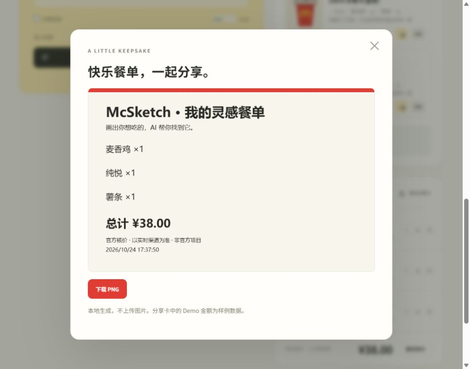

# McSketch 真实 MCP 联调报告

日期：2026-10-24（北京时间）。最后一轮脚本启动于 17:33:53；状态 passed，authenticated_business_chain=true。证据为 [mcp-live-audit.json](../artifacts/mcp-live-audit.json)。本次直接修改现有项目，没有重建或增加交易能力。

## 结论与范围

有效 Token 下的官方 Streamable HTTP 认证、tools/list、五个工具、真实菜单匹配/购物车、官方核价、三种预算修复及分别再次核价已通过。本次使用公开测试地标选取真实营业门店；没有读取设备定位、用户地址或账户订单，没有创建订单、支付、兑换积分或领取权益。

成功仅代表本次门店、当前在售菜单、到店取餐（orderType=1、beType=1）与官方默认规格。不是配送/预约/所有复杂规格/所有门店覆盖，也不是服务可用性或商业资格保证。

## 凭据与协议

- 安全检查 .env 存在、Token 非空、load_dotenv 后加载值与文件一致，结果仅布尔值；从未打印 Token、摘要或长度。已有系统环境变量优先，后端已重启加载。
- 使用官方 mcp Python SDK 的 streamable_http_client、ClientSession、initialize、tools/list、tools/call；每次调用按真实 inputSchema 校验。远端为 https://mcp.mcd.cn，Bearer 请求头仅由后端构建。
- tools/list 真实发现并保留五个只读工具的 Schema；完整 Schema 仅放已忽略的 private/。程序允许列表拦截所有其他工具。

## 各 Tool 的真实结果

以下次数仅计最后一轮脚本，浏览器检查和先前探测不混入计数。成功须为业务响应 success=true；未以 HTTP 200 代替业务成功。

| Tool | 成功 / 失败 | 验证能力 |
|---|---:|---|
| query-nearby-stores | 1 / 0 | 城市+关键词查询；真实返回 5 家门店 |
| query-meals | 1 / 0 | 真实门店在售菜单；126 条 SKU 字典记录 |
| query-meal-detail | 9 / 0 | 详情、官方默认子项/特制参数、精确营养名称与核价规格 |
| list-nutrition-foods | 1 / 0 | 实际 TOON 字符串解码，观察到 160 行营养数据，精确名称关联成功 |
| calculate-price | 23 / 0 | 原单、候选搜索和最终三方案重新核价，读取实际应付字段 |

tools/list 的认证读取同样通过。原始门店编码、地址、经纬度、traceId、账号信息不进入本报告。

## 真实字段修复

1. 原自动适配仅支持数组，真实 data.meals 是 SKU→商品的字典；现在保留原 key 为商品 ID，解析真实 name/currentPrice。参考价是元字符串，转换为整数分，price_verified=false。
2. 附近查询使用真实 beType/searchType/city/keyword；菜单、详情和核价携带实际 storeCode/orderType/beType。内部 id/qty 转成官方 productCode/quantity；取餐不传 beCode。
3. list-nutrition-foods 的 data 为平面 TOON，不是 JSON 数组。按真实表头解码，校验行数、列数、转义和类型；非支持格式失败，不填默认营养。
4. 详情 rounds 中的默认子项及 modification 使用真实 isDefault、quantity、selectedKey、unselectedKey。缺少必要默认值直接报错，不自行选规格。仅默认选择，未开发自定义加价规格。
5. 菜单“薯条”实际详情“中薯条”、可乐默认“可乐小杯”，先解析实际详情再精确关联营养。未知过敏原仍未知。
6. 官方应付金额为 data.price、单位分。不会用 currentPrice 求和、originalPrice 或 discount 冒充官方报价。
7. 实测首次把“三件套”当单一汉堡，导致营养无法精确关联、验收 incomplete。已将这类组合排除于单类绘画替代匹配，完整复测 passed；保留该失败说明，没有将首次失败写成通过。
8. 真实菜单候选多，Live 限定原品+每槽位两个同类低参考价替代品，再逐组官方核价；这改变搜索范围，不改变真实性，不宣称全菜单最优。详情/营养短缓存，报价不缓存。
9. 前端旧报价到期曾有与待返回新请求竞争的风险；过期只清理旧金额/方案，不修改餐单 revision，用户真正改餐单仍会丢弃过时返回。新增回归测试通过。

## 只读端到端实测

真实门店菜单 → 汉堡类别匹配 3 个 → 详情营养 → 实际菜单商品加入内部购物车 → 官方核价 → 预算修复 → 每方案再次官方核价。

原单：巨无霸、薯条、可乐，各 1 份，默认规格。偏好优先保留巨无霸，预算 4700 分；未设置忌口、热量上限或硬锁定。

| 餐单 | 官方金额 | 再次核价一致 | 满足预算 | 与原单不同 |
|---|---:|---|---|---|
| 原单 | ¥48.50 | 基准 | 否 | — |
| A 最少修改 | ¥40.00 | 是 | 是 | 是 |
| B 价格优先 | ¥38.00 | 是 | 是 | 是 |
| C 偏好优先 | ¥46.50 | 是 | 是 | 是 |

这是当时指定门店/时段的实际返回，不是永久价格承诺。报价 120 秒失效，采用或修改餐单后重新核价。

## 浏览器实际检查

本次从页面读取真实 Schema、查询 5 家门店并启用 Live；人工确认汉堡/薯条/饮料类别，加入培根蔬萃双层牛堡、薯条、雪碧。详情提示返回牛堡 442 kcal、蛋白质 24g、脂肪 23g。原单官方 ¥47.50，预算 ¥40，页面得到 A/B/C 为 ¥40/¥38/¥40。未设置软偏好时 A/C 一致是正常目标重合。采用 B 后重新官方核价 ¥38，生成 PNG，实际下载文件与页面预览逐字节一致。切回 Demo 后购物车 0、总额 0、样例来源标识恢复，未捕获浏览器 warning/error。页面本次用人工类别继续，CLIP 手绘检查沿用此前记录，不写成本轮重新做过推理。

[页面实际生成 PNG](screenshots/live-meal.png)。截图避开了真实门店定位区域，不含凭据。

## Demo、故障与脱敏

Demo 返回 source=demo、official=false；Live 返回 source=live、official=true，金额取自真实 calculate-price。Live 失败不自动混入 Demo；用户明确切回 Demo 时清空门店餐单与旧报价。两种模式指纹分离，非法商品不跨门店使用。

401/403、限流、超时、业务失败、空结果和字段漂移有自动测试；本次未故意制造真实限流或失效凭据，不能声称生产故障分支已实测。错误不给出底层凭据异常。

公开报告仅阶段、数量、金额和状态。8 份本地响应快照已去除 Token、电话号码、账号标识、门店位置/编码和 traceId；本地验收输入/Schema 留在 private/ 用于复现，全部排除发布。发布扫描还对实际配置的 Token 字节进行比对，包含媒体文件，报告不输出值或哈希。

## 自动测试与限制

最新完整结果：Python pytest 109 项通过；前端 7 项通过；TypeScript/Vite 构建通过；pip check 通过。新增合成结构夹具覆盖 TOON、真实字典形状、默认规格/特制、精确营养、报价分单位、空结果/业务失败、引用价与实际应付差异、无报价缓存和模式分离；这些夹具明确是 Mock，不当作真实联调证据。

CLIP 本轮未变更，保留先前真实模型评测：18 张食物 Top-1 命中 17 张，4 张非食物不确定，空白拒绝；coffee-cluttered 为高分误判。不是独立准确率基准，没有借本轮 MCP 测试声称重新评测模型。

仍未覆盖：配送、预约、多门店矩阵、优惠券条件、任意自定义套餐/加价规格、真实生产故障、负载与物理触屏。热量/忌口受官方数据完整性限制；缺失不能视为安全。首次运行仍需下载模型；发布 ZIP 不含权重与本机环境。

## GitHub 与报名

四个规定文件及配置示例、可运行源码、依赖、README 截图/GIF、Skill、测试记录均已备齐。CONTEST_DECLARATION.md 按官方字节原样保留。最终安全扫描 119 个发布条目，实际 Token 字节及凭据签名无发现，16 项 Git 忽略检查通过，声明与官方逐字节一致。发现 .env.example 缺失后已恢复空 Token 模板，没有修改真实 .env。ZIP 隔离解压后（复用本机 Python 依赖、移除 Token 进程变量）首页 200、13 条 Demo 菜单、三种方案均满足预算且 official=false，未配置 Token 的 Live 明确阻止。未描述为全新电脑安装验证。结果见 release-audit.json 与 artifacts/mcsketch.zip。

未初始化 Git、未创建/上传 Public 仓库、未代报名。按 [官方规则](https://github.com/M-China/mcd-developer-innovation-challenge/blob/main/activityGuidelines.md)，报名截止为北京时间 2026-10-25 23:59。下一步由本人确认声明及资格、上传个人公开仓库、填项目名称/地址/简介并查看官方 Issue 成功回复；可复制正文见 [提交步骤](CONTEST_SUBMISSION.md)。未使用 WorkBuddy，不提供虚构证明。
